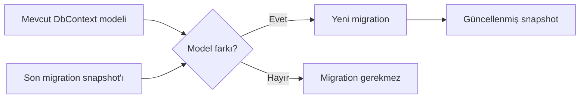

> **Yazı dizisi:** .NET ile güvenli AI uygulamaları — Bölüm 3/6. Bu metin ürün duyurusu değil, [VirtualBank](https://github.com/erata/virtual-bank-agent) projesini örnek alan, başka projelere de uygulanabilecek mühendislik rehberidir.

**Yayın özeti:** Entity'den tablo oluşturmak, PostgreSQL'in native güvenlik özelliklerinden vazgeçmek zorunda olduğumuz anlamına gelmiyor. VirtualBank'te Code First, versioned migration ve RLS'yi nasıl ayırdığımı gösteriyorum.


<!--more-->

## İki farklı sorumluluk

Customer, Credit ve Documents veritabanlarını ayrı `DbContext`'ler yönetiyor. Persistence entity'leri ve Fluent API ile `PK`, `FK`, `CHECK`, `UNIQUE`, indeks ve ilişkiler tanımlanıyor. PostgreSQL'e özgü `CREATE POLICY`, `ALTER TABLE ... FORCE ROW LEVEL SECURITY` ve `GRANT` komutları ise migration'ların versioned SQL bölümünde yer alıyor.

**Code First** “hiç SQL yazmayacağım” demek değildir. Entity modelinin tek otorite olduğu ilişkisel şema ile veritabanına özgü güvenlik DDL'si aynı migration geçmişinde ilerleyebilir.

```csharp
// VirtualBank'deki CustomerDbContext modelinden sadeleştirilmiş örnek.
e.HasOne(x => x.Customer)
 .WithMany(x => x.Accounts)
 .HasForeignKey(x => x.CustomerId)
 .OnDelete(DeleteBehavior.Restrict);
e.HasIndex(x => x.CustomerId).HasDatabaseName("accounts_customer_id_idx");
e.Property(x => x.Balance).HasPrecision(14, 2);
```

Ayrı migration adımlarında tablo/indeksler oluşturulur, synthetic seed uygulanır ve ardından RLS güvenlik politikaları etkinleşir. Runtime API bağlantı kimliğinin migration DDL izni yoktur.

## Migration snapshot neden kritik?

EF Core yeni migration üretirken mevcut `DbContext` modelini **önceki migration'ın snapshot'ı** ile karşılaştırır. Eğer snapshot doğrudan güncel `CustomerDbContext.ConfigureModel()` metodunu çağırırsa, eski model ile yeni model aynı hale gelir ve farklar kaybolabilir. Bu nedenle snapshot'ın **donmuş** bir model olması gerekir.



VirtualBank'te bu bağımsızlık kaynak kodu kontrolüyle denetlenir. Ama gerçek doğrulama için `dotnet ef migrations has-pending-model-changes` komutunu üç context üzerinde çalıştırmak gerekir. **Burada üretilmiş dosyaların gerçek EF model çıktısına eşdeğerliği canlı SDK ile ayrıca doğrulanmalıdır.**

## RLS'yi neden migration SQL'inde tutuyorum?

Entity üzerinde `[Authorize]` gibi bir attribute kullanmak DB seviyesinde erişim kontrolü üretmez. PostgreSQL policy, DB rolü ve transaction-local identity bağlamı ister. Örnek:

```sql
ALTER TABLE customer.customers ENABLE ROW LEVEL SECURITY;
ALTER TABLE customer.customers FORCE ROW LEVEL SECURITY;

CREATE POLICY customers_read_by_branch ON customer.customers
  FOR SELECT TO customer_api
  USING (authz.has_permission('customer.read')
         AND branch = authz.branch());
```

`CustomerDbContext`'i bir EF migrator hesabı kullanır, normal read/write use case'leri ise RLS korumalı Npgsql session'larını kullanır. Böylece “EF entity migration var” ile “tüm runtime sorguları EF LINQ” iddialarını birbirine karıştırmıyoruz.

## İlk kurulum ve eski şema sorunu

Önceki VirtualBank sürümleri SQL dosyalarıyla tablolar oluşturuyordu. Yeni sürümün EF migration history'sini mevcut eski şema üstüne sahte olarak yazmak veri kaybına veya şema uyuşmazlığına neden olabilir. Bu yüzden migration aracı eski şemayı algılarsa **fail closed** davranır. Demo verisini silmek istersen önce yedek ve açık onay gerekir; gerçek sistemde veri taşıma migration'ı gerekir.

## Referans proje için yayın kontrolü

1. Her context için `dotnet ef migrations has-pending-model-changes` sonucu temiz olmalı.
2. Boş DB'de migration + seed başarıyla tamamlanmalı.
3. `customer_api`, migrator rolü olmadan DDL yapamamalı.
4. RLS için hem allowed hem denied sorgular gerçek PostgreSQL'de denenmeli.
5. Migration rollback'inin güvenlik policy'sini sessizce kaldırmasına izin verilmemeli.

**Özet:** Kodun okunabilirliğini sağlayan EF Core ile veri sınırını koruyan PostgreSQL aynı problem için farklı katmanlarda çalışır. Senior düzeyde tasarım kararı, bu iki sorumluluğu ayırıp birlikte test edebilmektir.

## 2026 doğrulama durumu ve sınırlar

Güncel referans uygulama tek seferlik EF Core migrator, versiyonlu PostgreSQL policy SQL, pending-model-difference kontrolü ve DB yetkilendirme testlerini dokümante ediyor. CI tanımında build, unit test, EF drift ve RLS kontrolleri yer alıyor; çalıştırma bağlantısı ve commit hash'i olmadan her job'ın geçtiği iddia edilmemeli. Kullanıcı onaylı veri değişikliklerinde de yetki yeniden kontrol edilir. RLS normal runtime kimliği altında sorguları sınırlar; tamamen ele geçirilmiş ve transaction bağlamını taklit edebilen API host'una karşı tam koruma değildir. Bkz. [validation status](https://github.com/erata/virtual-bank-agent/blob/main/docs/VALIDATION_STATUS.md).


## Adım adım: Şemayı ve güvenlik politikasını birlikte taşımak

**Adım 1 — Sahipliği ayır.** EF Core tablo, ilişki, index ve constraint gibi ilişkisel şemayı yönetir. PostgreSQL'e özgü RLS politikaları sürümlenmiş migration SQL'inde veya denetlenebilir EF migration adımlarında yer alır. EF model snapshot tüm DB güvenlik politikalarını temsil etmez.

**Adım 2 — Migration üret ve denetle.** Modelden migration oluştur, üretilen SQL'i oku ve güvenlik ifadelerini bilinçli ekle. Hassas tablolara kısıtlı uygulama rolü erişmeden önce RLS etkin ve policy tanımlı olmalı.

**Adım 3 — Veritabanı rolünü doğru seç.** Tablo sahibi veya `BYPASSRLS` yetkili roller sıradan kontrolleri aşabilir. `FORCE ROW LEVEL SECURITY` tablo sahibini de kapsayabilir; ayrıcalıklı bypass yetkisi hâlâ önemlidir. Migration kullanıcısını runtime DB hesabından ayır.

**Adım 4 — Bağlamı transaction ile sınırla.** Connection pool aynı bağlantıyı farklı kullanıcıya verebilir. Güvenilir RLS context'ini transaction içinde ayarla, isteğin sonunda sızmamasını sağla. Kullanıcı kaynaklı SQL parçalarını context komutuna birleştirme.

**Adım 5 — Boş veritabanından test et.** Migration'ları temiz PostgreSQL'e uygula. Ardından **gerçek runtime rolüyle** yetkili ve yetkisiz erişimleri dene. Migration drift testini ayrıca çalıştır. EF migration'ın başarıyla bitmesi, RLS'nin doğru çalıştığının kanıtı değildir.

**Tipik hata:** Migration sahibi tüm satırları görebildiği için testler yeşildir; API de yanlışlıkla aynı ayrıcalıklı hesabı kullanınca gereğinden çok kayıt döndürür. Çözüm prompt veya frontend filtresi değil, runtime credential ve entegrasyon testidir.

Detaylar: [mimari notları](https://github.com/erata/virtual-bank-agent/blob/main/docs/architecture.md) ve [EF doğrulama rehberi](https://github.com/erata/virtual-bank-agent/blob/main/docs/EF_SNAPSHOT_VERIFICATION.md).


### Yazı dizisinde gezinme

[VirtualBank kaynak kodu](https://github.com/erata/virtual-bank-agent)

[← Önceki: Keycloak, RBAC, ABAC ve PostgreSQL RLS](https://webritmi.com/2026/11/25/keycloak-rbac-abac-postgresql-rls-jwt-musteri-verilerine-erisim) · [Sonraki: Semantic Kernel ile bankacılık AI Agent →](https://webritmi.com/2026/11/25/semantic-kernel-bankacilik-ai-agent-llm-secer-uygulama-karar-verir)
