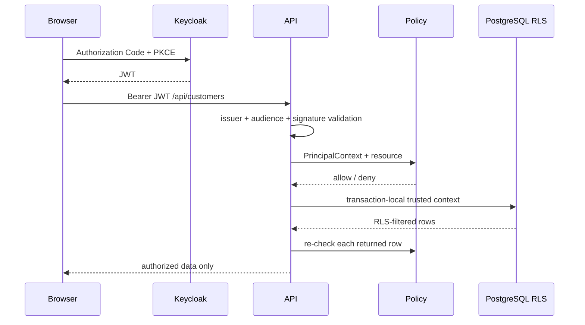

> **Yazı dizisi:** .NET ile güvenli AI uygulamaları — Bölüm 2/6. Bu metin ürün duyurusu değil, [VirtualBank](https://github.com/erata/virtual-bank-agent) projesini örnek alan, başka projelere de uygulanabilecek mühendislik rehberidir.

**Yayın özeti:** Kullanıcının oturum açmış olması, her müşteriyi görebileceği anlamına gelmez. VirtualBank'te Anna, Mehmet ve Deniz örnekleriyle authentication ile authorization arasındaki farkı uygulama ve veritabanı katmanlarında ele alıyorum.


<!--more-->

## Authentication sorusu: Sen kimsin?

Angular arayüzü Keycloak üzerinden OIDC Authorization Code + PKCE akışını kullanır. Kullanıcı oturum açınca API'ye bearer token gönderir. ASP.NET Core imzayı, issuer'ı, audience'ı ve süresini doğrular. `PrincipalResolver` doğrulanmış claim'lerden `PrincipalContext` üretir. Roller, Keycloak'ta taşınır; bu rollerin application permission'larına eşlemesi `policies/permissions.json` dosyasından yapılır.

Burada JWT **kimlik beyanıdır**; müşteriye erişim kararı değildir. `realm_access.roles` içinde `customer-advisor` bulunması tek başına tüm müşterileri göstermez. Branch claim'i ve müşteri kaydının branch'i de dikkate alınır.

## Üç persona, üç farklı erişim yolu

| Persona | Durum | Erişim kuralı |
|---|---|---|
| Anna (`anna.berater`) | Stuttgart müşteri danışmanı | `customer.read` + branch eşleşmesi |
| Mehmet (`mehmet.kredit`) | Kredi analisti | Kendisine atanmış krediyle ilişkili müşteriler |
| Deniz (`deniz.customer`) | Banka müşterisi | `customer.read.self` + doğrulanmış JWT `sub` |

Deniz, API'ye başka bir `customerId` yazsa bile başka kişinin IBAN'ını alamamalı. Bu nedenle self-service tool'larının çoğu dışarıdan müşteri ID'si kabul etmez; mapping, güvenilir JWT `sub` değerinden yapılır.



## Neden iki kere yetkilendirme?

Application katmanı iş kurallarını ifade eder: danışman kendi şubesini, analist atandığı kredinin müşterisini, müşteri yalnızca kendini görür. PostgreSQL RLS aynı sınırları veri erişiminin en altında tekrar uygular. Böylece biri yanlışlıkla `WHERE branch = ...` filtresini SQL'den çıkarsa bile DB erişimi kısıtlar.

VirtualBank'in migration'ında örneğin şu tür policy bulunur:

```sql
CREATE POLICY customers_read_own ON customer.customers
FOR SELECT TO customer_api
USING (
  authz.has_permission('customer.read.self')
  AND identity_subject_id IS NOT NULL
  AND identity_subject_id = authz.principal_id()
);
```

Bu örnek yalnızca gerçek backend tarafından doğrulanmış, transaction-local `app.principal_id` bağlamı kullanıldığında güvenilirdir. Tarayıcının istediği rastgele kimlik bilgisi DB session'ına kopyalanmamalıdır.

## `FORCE ROW LEVEL SECURITY` ve least privilege

API normal çalışma sırasında `customer_api` gibi ayrı bir veritabanı rolüyle bağlanır; migrator hesabıyla bağlanmaz. Tablo sahibi ve migration yetkileri ayrı tutulur. `FORCE ROW LEVEL SECURITY`, tablo sahibinin normal RLS muafiyetini de kaldırır; `BYPASSRLS` ayrı bir risk olarak kapalı tutulmalıdır. Transaction-local ayarlar istek sonunda temizlenir.

Bu yaklaşım **tam bir güvenlik sınırı değildir**: API süreci ele geçirilirse saldırgan güvenilir DB oturumu bağlamını taklit edebilir. Burada tehdit modeli ve güvenlik kontrolünün kapsadığı hata sınıfı açıkça ifade edilmeli.

## Nasıl test etmeli?

Pozitif ve negatif senaryolar beraber gereklidir. Anna'nın Stuttgart kaydını görmesi yetmez; başka şube kaydını görmemesi de doğrulanmalı. Deniz'in kendi IBAN'ını görüp Thomas'ınkini göremediği test edilmeli. Ayrıca role veya context eksikse sorgu **0 satır** döndürmeli. Bu nedenle `tests/database/rls-tests.sql` ve `self-service-rls.sql` gerçek PostgreSQL üzerinde çalıştırılır.

## Sık karıştırılan nokta

`403 Forbidden` (işlemi yapma izni yok) ile `404 Not Found` (kaynağın varlığını açıklamamak) farklı senaryolar olabilir. Kredi kaydının varlığını yetkisiz kişiye sızdırmamak için güvenli disclosure kararı gerekir. Bu karar, LLM'e bırakılmaz.

**Özet:** Keycloak giriş kapısıdır. İş nesnesinin okunmasına ise ASP.NET Core authorization policy, resource relationship ve PostgreSQL RLS birlikte karar verir. Agent eklendiğinde bu kontroller aynen korunmalıdır.

## 2026 örneği: administrator olmak bankacılık verisi yetkisi değildir

Güncel demoda platform admin kişisinin müşteri verisi talebi yönetici rolüne rağmen reddedilir. Müşteri danışmanı yalnızca kendi şubesinin müşterilerini listeler; kredi verisi için ayrı izin gerekir. Kredi onaylayıcıda tutar limiti ve four-eyes kuralı geçerlidir. Belge aramasında `document.read`, clearance, şube, allow/explicit-deny ACL, top-K öncesi SQL RLS ve metin LLM'e girmeden Application `DocumentReadPolicy` kontrolü bulunur. Keycloak güvenilir kimlik iddiaları sağlar; tüm iş verilerine otomatik erişim sağlamaz.


## Adım adım: Access token'dan yetkili veri satırına

**Adım 1 — Kimlik doğrula, token'ı da doğrula.** Token tek başına yetki değildir. API; imza, issuer, audience ve süreyi doğrular; güvenilir principal context oluşturur. Frontend'deki rol etiketi güvenlik kararı vermez.

**Adım 2 — Genel izinleri eşle.** RBAC `customer.read` veya `credit.approve` gibi işlemin denenip denenemeyeceğini belirler. Platform yöneticisinin otomatik olarak müşteri verisi okuyabildiğini varsaymayız.

**Adım 3 — Somut kaynağı kontrol et.** ABAC/resource policy şu soruları sorar: *Hangi müşteri, şube, atanmış kredi, doküman sınıfı ve clearance?* Danışmanın `customer.read` izni olması her şubeyi görebileceği anlamına gelmez.

**Adım 4 — PostgreSQL'de ikinci sınırı uygula.** RLS bypass etmeyen kısıtlı veritabanı rolü görünür satırları sınırlar. Sunucu, transaction içinde doğrulanmış kimlikten güvenilir RLS session context'i üretir. Tarayıcı veya LLM bu güvenilir bağlamı tayin edemez.

**Adım 5 — Negatif ve pozitif test yaz.** Danışmanın farklı şubedeki müşteriye erişimi, admin'in müşteri kayıtlarını istemesi, onaylayanın limit aşması reddedilmeli. Yetkili erişim de çalışmalı: herkese boş sonuç döndüren uygulamaya güvenli demeyiz.

```text
401: Kimlik doğrulanmadı
403: Kimlik doğrulandı ama işlem yetkisi yok
200 + kapsamlı sonuç: İşlem ve ilgili satırlar için yetki var
```

**Sınır:** Güvenilir API host tamamen ele geçirilirse RLS context'i taklit edilebilir. Bu yüzden kısıtlı DB rolü, least privilege, Application policy ve audit birlikte düşünülür. VirtualBank'in [authorization modelini](https://github.com/erata/virtual-bank-agent/blob/main/docs/authorization-model.md) ve [threat modelini](https://github.com/erata/virtual-bank-agent/blob/main/docs/threat-model.md) inceleyebilirsin.

---

### 📚 Yazı dizisinde gezinme

⬅️ **Önceki yazı:** [Clean Architecture](https://webritmi.com/2026/11/25/clean-architecture-moduler-monolit-sorumluluklar-bagimlilik-kurallari)

➡️ **Sonraki yazı:** [EF Core Code First ve PostgreSQL RLS](https://webritmi.com/2026/11/26/ef-core-code-first-postgresql-rls-birlikte-nasil-yasar)

🔗 **Kaynak kodu:** [VirtualBank — GitHub](https://github.com/erata/virtual-bank-agent)

