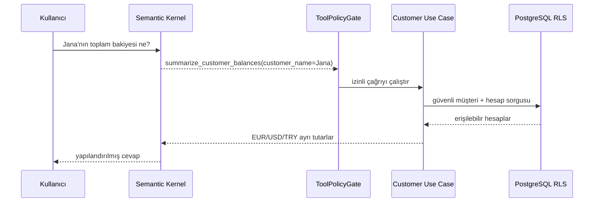

> **Yazı dizisi:** .NET ile güvenli AI uygulamaları — Bölüm 4/6. Bu metin ürün duyurusu değil, [VirtualBank](https://github.com/erata/virtual-bank-agent) projesini örnek alan, başka projelere de uygulanabilecek mühendislik rehberidir.

**Yayın özeti:** “Jana'nın parası kaç?” ve “Wie hoch ist Janas Guthaben?” aynı amaca işaret edebilir. Yapay zekâ cümleyi anlamalı; güvenlik, hesaplama ve veriye erişim ise C# uygulamasının sorumluluğunda kalmalı.

## Anahtar kelime eşleştirmesi neden yetmez?

VirtualBank'in erken sürümünde `OfflineAssistantRuntime`, `müşterilerimi göster` cümlesini tanırken `müsterilerimi listele` veya “Jana'nın toplam parası” gibi varyasyonlarda yanlış tool çağırabiliyordu. Bu yaklaşım test senaryolarında deterministik sonuç verir ama genel bir doğal dil anlayışı sunmaz. `ASSISTANT_PROVIDER=Offline` bu yüzden **yalnızca test yönlendiricisidir**, yerel bir dil modeli değildir.

Gerçek modda Semantic Kernel, kullanıcı sorusunu, kullanmasına izin verilen araç şemalarını ve konuşma bağlamını GPT-4o gibi bir LLM'e verir. Model bir tool adı ve argümanlar önerir. Ardından C# yürütücüsü `ToolPolicyGate` ile bütçeyi, yetkiyi, argümanı ve risk sınıfını denetler.

## Tool şeması bir sözleşmedir

`AssistantToolCatalog` içindeki `summarize_customer_balances` açıklaması “bakiye, money, Guthaben, toplam para” gibi **semantik örnekler** içerir. Bunlar `if (text.Contains(...))` kuralları değildir; modelin aracı ne zaman kullanacağını anlamasına yardım eden sözleşmedir. Yeni cümleler için her seferinde C# kodunu değiştirmemeyi hedefleriz.

Bir diğer temel kural: model **SQL yazmamalı**. Tool, mevcut `SummarizeCustomerBalancesHandler` üzerinden yetkilendirilmiş `ListCustomersHandler` ve `ListCustomerAccountsHandler` akışını kullanmalı. Banka hesaplarının gerçek bakiyeleri embedding veri tabanından tahmin edilmez.

## Aynı soru, farklı kullanıcı

Anna müşteri danışmanıysa kendi branch'indeki müşterileri; Mehmet kredi analistiyse kendisine atanmış başvurularla ilişkili müşterileri görebilir. Deniz self-service müşterisiyse “bakiyem” sorusu yalnızca kimliği doğrulanmış kendi hesabına gider. Admin Lena'nın sistem yönetimi rolü iş verilerine otomatik okuma izni sağlamaz. Bu nedenle UI'daki örnek sorular da `GET /api/assistant/capabilities` üzerinden kullanıcının yeteneklerine göre belirlenmelidir.

## Yanlış tool çağrısı ne olacak?

Model müşteri ID'si yerine rastgele metin gönderirse argüman doğrulaması reddetmeli. Kullanıcının yetkisi yoksa backend deterministik uyarı kodu üretmeli. Güncel sürümde kredi onaylama/reddetme işlemi insan onaylıdır: model tek kullanımlık bir onay kartı hazırlar; uygulama ise kullanıcının açık onayıyla yetki, limit ve four-eyes kontrollerini yeniden yapar. Transfer, standing order, kredi başvurusu ve şube vezne işlemlerinde de modelin isteği tek başına kalıcı değişiklik oluşturmaz. Agent'ın “Ben onayladım” yazması bir işlemin gerçekten yapıldığı anlamına gelmemeli; write işlemlerinin sonucu uygulama tarafından doğrulanmalı.

**Önemli ayrım:** Tool'ların LLM'e gösterilme kuralları (Hide/Explain) güvenliğe yardımcı olur, ama asıl yetki kontrolü her invocation'da server tarafındadır. Model tool adını tahmin edebilir; server yine kontrol eder.

## Offline, Ollama, OpenAI ve OpenRouter

- **Offline:** Tekrarlanabilir testler, gerçek model yok.
- **Ollama:** Bilgisayarda yerel model; model kurulumuna ihtiyaç var.
- **OpenRouter:** `openai/gpt-4o` gibi servis modellerini tek API üzerinden seçmek için.
- **Direct OpenAI:** Ayrı API anahtarıyla doğrudan model servisine bağlanmak için.

Chat modeli ile embedding modeli ayrıdır. GPT-4o function calling yapar; PDF parçalarının vektöre dönüştürülmesi için `text-embedding-3-small` veya `bge-m3` gibi bir embedding modeli gerekir.

## Nasıl doğrularım?

Aynı soruyu üç dilde sorarım. `toolCalls` alanındaki çağrılar doğru olmalı ve çok para birimli hesaplar EUR, USD ve TRY olarak ayrı gösterilmelidir. Yetkisiz müşteri için veri dökmemeli; `mode openrouter` görülmesi tek başına gerçek tool execution kanıtı değildir. Gerçek HTTP, Keycloak, use case ve DB testleri gerekir.

## 2026 güncellemesi: insan onaylı bankacılık işlemleri

Asistan artık yalnızca yetkili okuma değil, kullanıcıya sunulan yazma işlemlerini de destekliyor. Müşteri transferleri, kendi hesapları arası transfer, düzenli ödeme, kredi başvurusu, kredi onayı/reddi ve şube vezne işlemleri bunlara örnek. Yazma işlemi önce onay kartı olarak hazırlanıyor; aynı kullanıcının açık onayı ve güncel yetki kontrolü olmadan veritabanında yürütülmüyor. Angular üzerinde asistan kullanmadan da eşdeğer ekranlar var. Yerel modda Ollama `qwen3:4b-instruct` sohbet ve `bge-m3` embedding modeli kullanıyor; OpenRouter ve doğrudan OpenAI alternatif sağlayıcılar. `Offline` deterministik router ise **LLM değildir**.

Bkz. [gerçek ekran görüntüleri](https://github.com/erata/virtual-bank-agent#screenshots-same-app-different-roles-and-languages) ve [bankacılık işlemleri](https://github.com/erata/virtual-bank-agent/blob/main/docs/BANKING_OPERATIONS.md).

## Adım adım: LLM'in istediği işlemi güvenli çalıştırmak

**Adım 1 — İstek türünü ayır.** “IBAN'ım ne?” deterministik veri sorgusudur; “Ücret politikası ne diyor?” doküman aramasıdır; “Para gönder” ise veri değiştiren işlemdir. Üçünü de serbest SQL veya genel doküman tool'una bırakmak doğru değildir.

**Adım 2 — Dar kapsamlı tool tanımla.** Modele anlamlı isimler ve tipli parametreler ver. `get_my_profile` gibi bir tool hedef müşteriyi keyfî ID'den değil doğrulanmış subject'ten çözmelidir. Tool açıklaması seçim kalitesini artırır fakat access-control listesi değildir.

**Adım 3 — İstenen çağrıyı doğrula.** Tool kayıtlı mı, kullanıcının gerekli yetkisi var mı, argümanlar geçerli mi, kaynak erişim kapsamında mı, çağrı limitleri aşılıyor mu? LLM'in uydurduğu fonksiyon veya tahmin ettiği ID yetkiyi genişletememeli.

**Adım 4 — Güvenilir use case'i çağır.** Modelin yazdığı SQL'i çalıştırma; Application use case'ini kullan. Bakiye sorgusu EUR, USD ve TRY'yi farklı para birimleri olarak korumalı.

**Adım 5 — Öneri ile commit'i ayır.** Transfer veya kredi kararı önce kısa ömürlü, tek kullanımlık confirmation card üretir. İşlem ancak aynı kullanıcının açık onayıyla yürür. Onay anında sahiplik, limit, dört göz kuralı ve güncel DB durumu yeniden kontrol edilir. LLM tool çağrısı finansal işlem için son onay olamaz.

**Adım 6 — Hataları test edilebilir yap.** Türkçe, Almanca ve İngilizce farklı ifadelerle gerçek tool seçimini ve reddetme kodlarını kontrol et. OpenRouter/OpenAI ile Ollama yollarını ayrı doğrula; deterministik `Offline` router'a yerel LLM deme.

Bu yaklaşım yalnızca bankacılıkta değil HR, sigorta, iç operasyon ve kurumsal copilot sistemlerinde de kullanılabilir. VirtualBank'in [bankacılık işlemleri dokümantasyonu](https://github.com/erata/virtual-bank-agent/blob/main/docs/BANKING_OPERATIONS.md) somut örnek sunar.

**Sonuç:** Agent'ı güvenilir yapan şey modelin her şeyi bilmesi değil, yanlış tahmin yaptığında bile yetki ve işlem sınırlarının korunmasıdır.

### Yazı dizisinde gezinme

[← Önceki](./efcore-rls.md) · [Sonraki →](./secure-rag-pgvector.md) · [VirtualBank kaynak kodu](https://github.com/erata/virtual-bank-agent)
