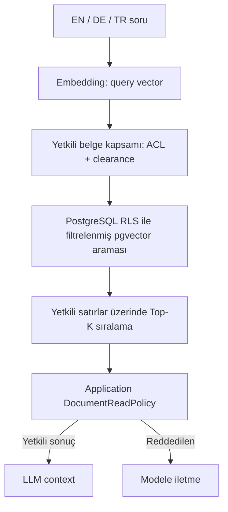

> **Yazı dizisi:** .NET ile güvenli AI uygulamaları — Bölüm 5/6. Bu metin ürün duyurusu değil, [VirtualBank](https://github.com/erata/virtual-bank-agent) projesini örnek alan, başka projelere de uygulanabilecek mühendislik rehberidir.

**Yayın özeti:** Bir kullanıcı Türkçe soru sorup Almanca kredi yönergesini bulabilir. Ama arama sonucu yetkisiz bir HR dokümanıysa sistem o metni modele hiç vermemeli. VirtualBank'in RAG tasarımı semantik aramayı yetkiyle birlikte ele alıyor.

<!--more-->

## RAG, canlı müşteri verileri için bir SQL alternatifi değildir

“Jana'nın IBAN'ı nedir?” sorusu bir Customer API use case'i gerektirir. “Kredi onay yönergesi nerede?” sorusu ise PDF/DOCX belge aramasını gerektirir. Bu iki veri türünü karıştırırsak güncel hesap bakiyesini eski bir embedding ile yanıtlamak gibi ciddi bir hata yapabiliriz.

VirtualBank'te belge kaynakları `sample-docs/` altında tutulur. Ingestion pipeline kaynak dosyaları okur, chunk'lara ayırır, embedding modeliyle vektörleri üretir ve 1024 boyutlu pgvector kolonuna kaydeder. Soru sorulduğunda aynı embedding modeliyle sorgu vektörü üretilir.

## Neden GPT-4o değil de başka embedding modeli?

GPT-4o doğal dilde cevap üretmek ve tool seçmek için bir **chat modelidir**. `openai/text-embedding-3-small`, vektör üretmek için bir **embedding modelidir**. İkisini aynı OpenRouter hesabından çağırmak mümkündür; görevleri farklıdır.

Provider veya embedding modeli değişince eski vektörler karıştırılmamalı, gerektiğinde belgeler yeniden indekslenmelidir. VirtualBank `embedding_model` bilgisini her dokümana kaydeder.

## En önemli karar: ACL aramadan sonra mı, önce mi?

Yetkisiz chunk önce top-5'e girip sonra filtrelenirse hem arama kalitesi bozulur hem bazı veri sızıntısı riskleri oluşur.

Tasarımda DB sorgusu RLS kapsamındaki belge/chunk satırları üzerinden çalışır; top-k bunlardan seçilir. Sonuçlar model context'ine eklenmeden önce `DocumentReadPolicy` ile bağımsız ikinci kontrol yapılır.

`clearance`, branch, rol, grup, kullanıcı ve explicit-deny birlikte değerlendirilir.

Bu kontrol RAG'in prompt'una yazılacak “gizli bilgileri gösterme” talimatından daha güçlüdür. Modelin görmediği bir chunk'ı özetleme şansı kalmaz.

Ancak **yetkilendirme, prompt injection'ı önlemez**; yalnızca olası etki alanını daraltır.

## Top-k sonucu gerçek kanıt mıdır?

Hayır. Cosine similarity yüksek çıkan belge de soruyu cevaplamıyor olabilir.

Bu nedenle `DOCUMENTS_MIN_SIMILARITY` bir minimum eşik sağlar; fakat eşik tek başına semantic entailment garantisi değildir.

Soruyla ilgili ve erişilebilir belge bulunamazsa modelin politika uydurmasına izin verilmemeli.

“Bunu erişebildiğim belgelerde doğrulayamadım” cevabı daha doğrudur.

## Çapraz dil değerlendirmesi

Örneğin kullanıcı “kredi istisnası nasıl yönetilir?” diye sorup Almanca bir açıklamayı bulabilmelidir.

Golden veri setinde her sorgu için beklenen document ID ve **asla görünmemesi gereken** HR/operasyon dokümanları tanımlanır.

`tests/evaluation/rag_golden.json` ve `tools/evaluate_rag.py` canlı API üzerinde Hit@K ve forbidden-hit sayısını hesaplamak için eklenmiştir.

Test geçmesi için hem pozitif hem negatif sonuç görmek gerekir:

- Sophie HR dokümanlarını bulmalı ama Mehmet bulamamalı.
- Mehmet kredi yönergesini bulmalı ama operasyon runbook'unu okumamalı.

Sıfır sonucunun yalnızca her şeyi bloklayan hatalı sistemden gelmediği bu şekilde anlaşılır.

## Sınırlar ve sonraki adımlar

Örnek belgeler sentetik ve küçüktür; retrieval kalitesini gerçek uzun bankacılık dokümanlarına genellememeliyiz.

HNSW indeksi, kaynak sayfası, revocation, citation doğruluğu ve fiyat/latency ölçümleri ayrıca test edilmelidir.

Özellikle belgelere erişim kaldırıldığında eski sohbet history'sinde hassas metin kalmaması ayrı bir problem olarak ele alınmalıdır.

## 2026 değerlendirme özeti: 30 doküman, 42 senaryo

Güncel sentetik veri kümesi **30 doküman** içeriyor:

- 8 PDF
- 7 DOCX
- 6 Markdown
- 5 TXT
- 4 JSON

Etiketlenmiş değerlendirmede **42 sorgu** var: Türkçe, Almanca ve İngilizce için 14'er örnek.

Çapraz dil retrieval, eski/güncel politika ayrımı ve kullanıcı rolüne göre görünürlük kontrol ediliyor.

Depoda kayıtlı temiz kurulum/OpenRouter embedding ölçümünde **Hit@5 %85,7** ve **değerlendirilen sorgularda sıfır yetkisiz isabet** raporlanmış.

Bu sonuç genel sızdırmazlık, prompt injection direnci veya üretim ölçeğinde başarı garantisi değildir.

Her iki model 1024 boyut kullansa bile embedding modeli ailesi değişince yeniden indeksleme gerekir.

Bkz. [RAG değerlendirme yöntemi](https://github.com/erata/virtual-bank-agent/blob/main/docs/RAG_EVALUATION.md).

## Adım adım: Yetkiyi koruyan retrieval akışı tasarlamak

**Adım 1 — Doğru bilgi kaynağını seç.**

Hesap bakiyesi, sahiplik ve transfer gibi canlı bilgiler transaction tabanlı use case'lerden gelmeli. RAG ise politika sürümleri, yönergeler, FAQ ve belge içerikleri içindir.

**Adım 2 — Kaynak ilişkisini koruyarak indeksle.**

PDF/DOCX/Markdown gibi kaynakları oku; doküman ID ve sürümünü sakla; chunk üret; ACL değerlendirmesine uygun metadata tut.

Embedding modeli ve boyutunu açıkça belirt. Chunk'tan kaynağa geri dönebilmeyi sağla.

**Adım 3 — Doğrulanmış principal ile sorgula.**

Soru embedding'ini uyumlu model ailesiyle üret.

Top-K sıralamasından **önce** okunabilir belge kapsamını uygula; aksi hâlde yetkisiz chunk'lar sıralamayı işgal edebilir ve izin kontrolleri kolayca bozulabilir.

**Adım 4 — Sonucu ikinci kez denetle.**

Sunucudan üretilen RLS context'i ve bağımsız Application document-read policy kullan.

Sınıflandırma, şube, rol/grup ACL ve explicit deny'ları LLM'e snippet göndermeden kontrol et.

Hangi belgenin görünür olduğuna model karar vermez.

**Adım 5 — Kaynaklı cevap üret.**

Kaynak ID'si göster; 2023 arşiv politikasıyla 2026 güncel politikayı ayır; yeterli yetkili kanıt yoksa bunu açıkça söyle.

Cosine similarity, doğruluk veya mevzuat geçerliliği garantisi değildir.

**Adım 6 — Kaliteyi ve sızdırmazlığı birlikte ölç.**

Türkçe/Almanca/İngilizce etiketli sorgularda Hit@K, reciprocal rank ve forbidden-hit sonuçlarına bak; pozitif kontrol ekle.

VirtualBank'te 30 sentetik doküman ve 42 etiketli sorgu var.

Belgelenen OpenRouter çalışmasında Hit@5 %85,7 ve **bu sorgularda** sıfır yetkisiz isabet raporlanıyor; bu evrensel güvenlik garantisi değildir.

**Ek senaryo:**

Kredi analisti 2026 kredi politikasına, sıradan müşteri ise yalnızca public ücret dokümanına ulaşabilir.

Aynı soru, model prompt'unda gizlenen ortak bir sonuç listesi yerine farklı **yetkili kaynak kümeleri** üretmelidir.

Detaylar için:

- [RAG değerlendirme yöntemi](https://github.com/erata/virtual-bank-agent/blob/main/docs/RAG_EVALUATION.md)
- [Doküman erişim modeli](https://github.com/erata/virtual-bank-agent/blob/main/docs/ROLE_DOCUMENT_ACCESS.md)

**Sonuç:** Başarılı RAG, en yakın beş parçayı bulmak değildir. Doğru, yetkili, kaynak gösterilebilir ve yetersiz kanıt varsa susabilen bir bilgi erişim sistemi kurmaktır.

### Yazı dizisinde gezinme

[VirtualBank kaynak kodu](https://github.com/erata/virtual-bank-agent)

[← Önceki: Semantic Kernel ile bankacılık AI Agent](https://webritmi.com/2026/11/26/semantic-kernel-bankacilik-ai-agent-llm-secer-uygulama-karar-verir)

[Sonraki: AI Agent'larda Prompt Injection →](https://webritmi.com/2026/11/25/ai-agentlarda-prompt-injection-guvenlik-sinirini-prompta-degil-uygulamaya-koymak)
